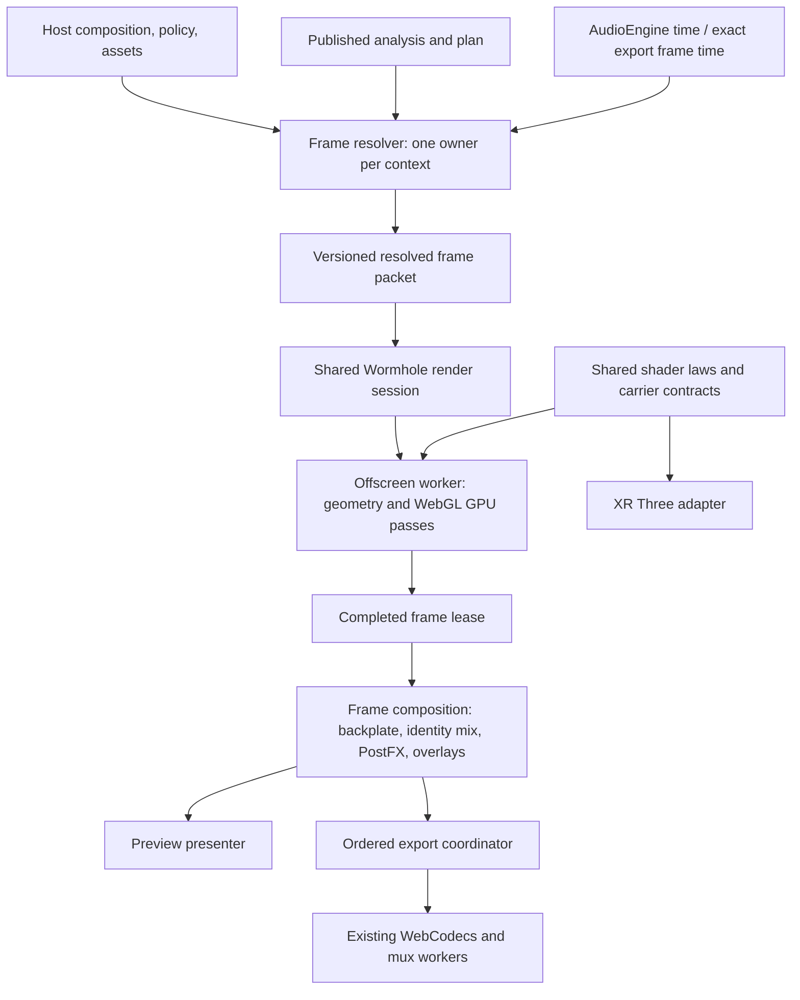

# Közös, workerben és GPU-n futó Wormhole: epic terv

Dátum: 2026-11-07, Europe/Budapest. Feltárt forrás: `9733a4a4aebf2ff0d68e41f8f3b102c0a40c52de`.
Állapot: WH-00, [WH-01 szerződés/baseline](wormhole-wh01-contract-baseline.md), [WH-02 GPU-próba](wormhole-wh02-gpu-spike.md) és [WH-03a frame-előkészítés](wormhole-wh03a-frame-preparation.md), [WH-03b időalapú burkolók/kanonikus képkérés](wormhole-wh03b-canonical-time.md) átadva. [WH-04 MVP GPU-session](wormhole-wh04-mvp-gpu-session.md) átadva. Következő WH-05 dashboard/kompozíció a kézi elfogadás után; az éles host/export GPU-integráció WH-04/05/06.
Integrációs felelős: az aktuális fejlesztési munkamenet egyetlen szerződésgazdája.

## 1. Cél és helye a főtervben

A sima host (a jelenlegi `src/main.ts` dashboard) és az MVP ugyanarra a közös
Wormhole-renderelő magra építse a lejátszását és az összes jelenleg támogatott
videóexportját. A támogatott eszközökön az Offscreen worker végezze a Wormhole
geometriájának előállítását, a GPU pedig az anyag, a szálak és a vonalak
raszterezését. A zenei időzítés, presetek, automatizáció és rétegsorrend maradjon
egyértelműen tulajdonolt és ellenőrizhető.

Ez az epic váltja fel a korábbi, csak exportra szűkített következő T20c2-spike
ütemezését. A GPU-spike a WH-02, az exportintegráció a WH-06 része lesz.
A T20c1 két-/négymunkaszálas CPU-kísérlete megőrzött negatív mérési referencia.
T21b/T21c, T22, T23 és T24 ezután következik; T25 minden tényleges kiadás kapuja.
A korábbi T15 és további Wall-fejlesztés halasztása érvényben marad.

Az első implementációs lépés WH-01. Minden implementációs task után: megfelelő
tesztek, dokumentáció, elkülönített kommit, push, ellenőrzött deploy, rövid
leírás a várható viselkedésről, majd kézi tesztelési megálló. Az első látványos
összehasonlítás WH-02-ben, az MVP teljes lejátszási átállása WH-04-ben, a sima
hosté WH-05-ben várható. Az export a WH-06 feladata. Ez függőségi sorrend,
nem naptári vagy már igazolt gyorsulási ígéret.

WH-02 döntés: a szigorú 2D referencia anyag/weave/bloom kapuit a vegyes
Float16-akkumuláció/Float32-szűrés teljesíti. A Canvas-vonalak ugyanabban a
workerben maradnak, amíg a külön GPU-vonalprofil is megfelel: két esetben még
elbukott a rögzített sötét tile kapun. Ez minőségvédett fallback, nem a teljes
GPU-vonalút promóciója. A WH-03a megkezdhető ezzel az anyagmaggal; WH-04-ben
a vonalpolicy és a képesség-/hiba-fallback explicit bekötést kap. A még nyitott
GPU-vonalminősítés nem jogosít küszöblazításra vagy csendes képcserére.

## 2. Mit igazolt a kódfeltárás?

| Útvonal | Jelenlegi működés | Igazolt hiány |
| --- | --- | --- |
| Sima host lejátszás | `main.ts:289` az Offscreen elérhetőségét `false` értékkel adja át; a renderer nem kap worker factoryt | A közös host-worker nincs bekötve. A WebGL-választás szinkron, főszálas raster pass |
| MVP lejátszás | `ui/mvp/main.ts:31,42` engedélyezi és beköti a `WormholeHostWorkerSource`-ot; friss beállításnál Offscreen az alap | Ez már működő optimalizáció, de a worker nem használja az XR külön GPU-s anyag- és vonalpasszát |
| Közös host-worker | `wormholeHostRender.worker.ts` saját, injektált állapotú identityt és WebGL/Canvas2D backendet használ | Az identity CPU-s anyagútját nem helyettesíti material sinkkel |
| Közös WebGL backend | `WebGLRendererBackend.ts:445,456` Float32 buffert vesz át, CPU-n hívja a `writeFieldRasterPixels`-t, majd feltölti a textúrát | A WebGL címke itt nem bizonyít GPU-s anyagszámítást |
| XR raster/hybrid háttér | `WormholeCanvasSource.configureIdentity` külső material/line sinket köt; a `WormholeBackdrop` külön GPU-passzokat és előkészített buffereket használ | Az algoritmus és a Three.js adapter összekapcsolása akadályozza a szabályos újrafelhasználást |
| Export mindkét hostban | `PlexusRenderer.ts:134` kizárja a host-workert exportkor; `WebCodecsBackend.ts:188–216` a normál ágon p5 redraw-t vár, majd bitmapet készít | A lejátszás worker-optimalizációja nem az export renderútja |
| Exportformátumok | Dashboard: jelenlegi WebM-felület. MVP: WebM/MP4, választható 10 bites profilokkal | A közös renderút minden meglévő formátumra vonatkozik; új dashboard-formátum menüje külön termékbővítés lenne |
| Pontos renderadapterek | `WormholeExactWorkerSource`, a v2 protokoll és a kutatási `WormholeExportRuntime` már létezik | Jelenlétük nem jelent éles bekötést vagy teljes dashboard/MVP-viselkedési azonosságot |
| Időfüggő állapot | `PlexusRenderer.ts:340,468` hívásonként léptet halványítást/lecsengést; a privát `WormholeFrameContext` több tranzienset abszolút időből projektál | A frissítési gyakoriságtól független egyezést külön kell bizonyítani |

Kapcsolódó tényleges források:
[host worker](../../src/visuals/WormholeHostWorkerSource.ts),
[worker](../../src/visuals/wormholeHostRender.worker.ts),
[renderer](../../src/visuals/PlexusRenderer.ts),
[XR anyag](../../src/xr/scene/GrainMaterialRenderer.ts),
[XR vonalak](../../src/xr/scene/GrainLineRenderer.ts),
[XR megjelenítés](../../src/xr/scene/WormholeBackdrop.ts),
[kódoló backend](../../src/export/WebCodecsBackend.ts).

A szűk Graphify-lekérdezés az MVP composition kapcsolatát jelezte; az exporthoz
kapott útvonal kétértelmű volt. Az itt felsorolt kapcsolatokat közvetlenül a
forrásban ellenőriztem. Új gráf, új mérési eredmény vagy shader-prototípus nem
készült ehhez a tervhez.

## 3. Az XR-ből átviendő működés

| Képesség | Közös megoldás | Hostfüggő rész |
| --- | --- | --- |
| Workerben futó geometria | Egy identity/context, előkészített analízis, generációellenőrzés | AudioEngine-idő és UI a hostban |
| Anyag és weave a GPU-n | Közös kapszulatörvény, zajazonosság, resolve és bloom | Plain WebGL2 adapter a workerhez; Three adapter az XR-hez |
| GPU-vonalak | Közös lefedettségi, premultiplied-alpha és blend-szabályok | Célsurface és végső kompozíció |
| Előkészítés és kettős buffer | Befejezett frame és társadatai együtt kerülnek megjelenítésre | Az XR szemrenderje előtti passz helyett a 2D host prezentációs határa |
| Adaptív preview pacing | Egy függő kérés, korlátos sor, elavult eredmények lezárása | Hostonkénti minőségi/frekvenciakeret és mért késés |
| Pause, seek, reset | Álló kép cache, változásra újrarajzolás, explicit epoch | A host hangéletciklusa és méretváltozása |
| Anyag, spirál, lens, cosmos | Ugyanazok az elfogadott zenei/optikai szabályok | Kamera/depth/preset alapértékek explicit host policyban |
| Hibakezelés | Worker-/GPU-képességpróba, context loss, takarítás | Használható helyi tartalékút és UI-visszajelzés |

A headset per-eye kamerája, runway, note-ok, kardok, cockpit, XR-native3d
kísérlet és méteres színpadgeometria XR-tulajdon marad. A Wall meglévő állapota
és Off alapértéke megőrzendő; új Wall-effektus nem része ennek az epicnek.
A preview felbontási korlátjai és prediktív időelőnye nem kerülnek át exportba.

## 4. Célarchitektúra és felelősségek

Ez logikai adatfolyam: a kompozíció egyszerű Wormhole-esetben ugyanabban a
worker/GPU contextben maradhat. A dashboard más identityje és a DOM videója
hostadaptert igényelhet. A végleges képkockaazonosság és rétegsorrend mindkét
elhelyezésnél ugyanaz a szerződés.

| Tulajdonos | Feladat | Határ |
| --- | --- | --- |
| Composition rootok | Sessionök, facade és backend factoryk létrehozása | A dashboard és az MVP ugyanazt a factoryt használja, host policyval |
| Visuals frame resolver | Tuning/morph, eseménycursor, moduláció/director és renderbemenet előállítása | Egy aktív tulajdonos/context; meglévő tiszta segédek újrahasználata |
| Visuals render session | Identity-geometria, anyag/vonal raszter, GPU-erőforrások | Nem tervez zenét, nem indít AudioEngine-t, nem ír globális State-et |
| Types | Verziózott DTO-k, frame identity, lease és képességek | Nincs DOM/UI/runtime import |
| XR adapter | Three textúrák, per-eye/színpad, XR-specifikus prezentáció | A közös shaderforrást fogyasztja; az MVP nem importál XR-runtime-ot |
| Export | Job, pontos idő, sorok, PCM, kódolás, fájl, Stop/Cancel | Worker csak adatot/explicit erőforrás-lease-t kap |
| UI facade és controls | Felhasználói műveletek, beállítás, állapotjelzés | Leaf vezérlő nem futtat DSP-t, GPU-t vagy exportmunkást |

Javasolt kódhelyek a meglévő tulajdonosi szerkezetben: kis GPU-modulok a
`src/visuals/gpu/` alatt, session/proxy a `src/visuals/` alatt, DTO a `src/types/`
alatt és jobadapter a `src/export/` alatt. A pontos fájlbontást WH-01 rögzíti;
a meglévő osztályokat átalakítjuk, nem építünk mellettük harmadik Wormhole-motort.

A megvalósítás előtt frissítendő az [architekturális szerződés](../governance/architecture-contract.md),
a [worker-szerződés](../governance/worker-communication.md), az
[ADR-009](../adr/ADR-009-xr-rhythm-game-host.md), az
[ADR-011](../adr/ADR-011-shared-wormhole-frame-context.md) és az
[ADR-012](../adr/ADR-012-isolated-export-job-runtime.md), valamint a határtesztek.
A közös, tiszta shadermodul XR-importjához szűk, explicit engedmény szükséges.
A `WebGLRendererBackend` jelenlegi szűk importlistájának változása is ebbe a
lépésbe tartozik. Ez a terv önmagában nem vezet be importkivételt.
Three.js továbbra is az XR-ben marad; `src/presentation/` nem lesz GPU-runtime.

## 5. Frame-, idő- és erőforrás-szerződés

### Egyetlen zenei és vezérlési tulajdonos

- A lejátszás ideje az AudioEngine-től jön; exportban `frameIndex / fps` és
  `round(frameIndex * 1000000 / fps)` az időbélyeg. Worker wall clock csak mérésre szolgál.
- A jelenlegi host által már feloldott tuningot nem etetjük be olyan XR-contextbe,
  amely ismét presetet, makrót, boostot és directort alkalmazna rá.
- A frame resolver kiemelése előbb viselkedésmegőrző refaktor (WH-03a). A hívásszámfüggő
  fade/decay javítása külön, rögzített elődreferenciával történik WH-03b-ben.
  Elfogadott tiszta idősegédek és szükség esetén kanonikus tick/checkpoint használható.
- A privát exportcontext explicit host policyt és konzisztens asset-revíziót kap.
  Az MVP .6-os depth cue-ja és a dashboard jelenlegi megjelenése nem cserélődik
  véletlenül XR-alapértékekre. Új zenei detector vagy második dramaturgia nem készül.
- A worker nem olvas State-et. Nincs globális State-csere await körül és nincs
  Promise-várakozás vagy worker-létrehozás p5 `draw()`-ban. A frame broker a draw
  életciklusán kívül fogadja a kéréseket; a draw egy kész lease-t prezentál.

### Két ütemező ugyanahhoz a renderelő maghoz

**Preview:** egy függő renderkérés és legfeljebb egy következő kívánt időpont.
Torlódáskor a következő kívánt idő frissül; nincs hosszú render-sor. A kompozitor
csak befejezett, azonos revíziójú képet fogad el. Pause alatt azonos frame nem
számolódik újra; paraméter-, méret-, seek- vagy assetváltozás invalidál.
Késéskompenzáció csak mért, korlátos prezentációs policy; seek/pause alatt nincs
prediktív előrefutás. Nem módosítja a zenét vagy az automatizációs pont idejét.

**Exact export:** minden kért frame eredményt vagy explicit hibát kap. Nincs
eldobott/duplikált frame, preview lead, 30 Hz-es korlát vagy 960 px-es exportcap.
Kezdetben egy renderkérés függőben és legfeljebb két encodernek átadott frame.
A 30 fps export is a jóváhagyott kanonikus szimulációból mintáz; támogatott további
fps-eket külön igazolni kell. Minden képkockánál nulláról visszajátszó, kvadratikus
exportút nem válhat normál hosszú exporttá; a megőrzött rewind-oracle tesztre használható.

### Verzió, lease, visszanyomás

Közös frame identity: `protocol`, `contextId`, `generation`, `requestSerial`,
`presentationRevision`, `songTime`; exact módban `jobId`, `frameIndex`, `timestampUs`.
Elemzés/preset és méret/minőség/backend revíziója konzisztens előkészítésből jön.
A kép, material, line és szükséges társadat együtt alkot egy frame-et. Ismeretlen
verzió, hibás bufferhossz, nem véges adat vagy rossz serial nem prezentálható.

Az elemzés renderhez szükséges projekciója egyszer kerül át load/context
revíziónként; a lejátszás AudioBuffer-csatornáit nem detacholjuk. Képkockánként
csak a szükséges resolved adatok mozognak, újrahasznált, korlátos bufferekkel.
A változásjelzés revíziókra épít, nem a teljes elemzés vagy teljes állapot
képkockánkénti JSON-szerializálására. Minden host/session saját contextet kap;
közös kód nem jelent hostok vagy tabok közt megosztott mutábilis runtimet.
Exportindításkor a preview munkája felfüggesztődik, erőforrásai a budget szerint
felszabadulnak; a job lezárásakor a preview explicit visszaállítást kap.

A producer kölcsönadott typed-array objektumát azonnal másoljuk vagy átadjuk az
explicit lease alatt. Bitmap/VideoFrame és GPU-target egyetlen tulajdonoshoz
tartozik; stale, Cancel, Stop, új load, context loss és dispose esetén pontosan
egyszer szabadul fel. Türelmi idő, workerhiba és inicializációs kudarc nem hagyhat
függő Promise-t vagy lezárt contextre mutató megjelenített textúrát.

### GPU és képminőség

A közös kernel a meglévő anyagkapszulát, weave-et, L0 resolve-ot, L1/L2 bloomot,
vonal-lefedettséget és színkeverést viszi át. A 24-float carrierben a 32 bites
azonosság két 16 bites fele megőrzendő. Az XR shaderforrás kinyerésének önmagában
ugyanazt a shaderprogramot kell előállítania az XR-adapterben.

Az XR jelenleg félpontosságú targeteket használ. A renderelhető float targetet és
a 32 bites float blending képességét külön kell próbálni; az extension neve mellett
tényleges framebuffer- és shaderpróba szükséges.
[Khronos color-buffer float](https://registry.khronos.org/webgl/extensions/EXT_color_buffer_float/),
[Khronos float blending](https://registry.khronos.org/webgl/extensions/EXT_float_blend/).

A rendercél numerikus pontossága és a kimeneti kodek 10 bites profilja külön
fogalom. A közös út megtartja az elfogadott formátumot, bitrátát, fps-t és képméretet.
Rögzíteni kell a lineáris/sRGB műveletek helyét, premultiplied/straight alphát,
flipY-t, additive/source-over sorrendet és ditheringet. A több GPU-tizedes önmagában
nem bizonyít szebb gradienst. A CPU/GPU bájtegyezést nem feltételezzük; külön
nyersképes, sötétrégiós és időbeli összehasonlítás kell a kódolás előtti referenciához.

## 6. Kompozíció, kompatibilitás és tartalékutak

- A két identity közti csere az ADR-006 szerinti súlyozott keverés; a közös
  particle/shockwave szimuláció pontosan egyszer lép. Az outgoing/incoming rétegek
  ugyanahhoz a frame identityhez tartoznak. A Wormhole workerre váró idő alatt nem
  keverünk frissebb másik identityt egy korábbi Wormhole-képpel.
- A dashboard más identityje szükség esetén main-thread p5 targetre rajzol ugyanazon
  frame előkészítésekor; ez a target a válaszig korlátosan megmarad. A teljes pár
  a visszaérkező Wormhole-lel együtt kerül a kompozitorba. A kompozícióhoz és
  PostFX-hez a frame saját, immutable resolved nézete jár, nem az időközben változó UI.
- PostFX egyszer fut a végső identity-kompoziton. Zenei kijelző, meglévő watermark,
  átlátszóság és videóháttér sorrendjét baseline rögzíti. T21 későbbi feliratának
  külön overlay-helye lesz; a feliratszerkesztő nem része ennek a munkának.
- A DOM videóelem a hostban marad. Exportnál a megfelelő időre dekódolt videókép
  explicit frame identityvel kerül a kompozícióba. Közös live videóelem és export
  nem versenyezhet seekeléssel. A teljes nem-Wormhole export továbbra is működik.
- Előnyben részesítjük a workerben/GPU-n maradó rétegeket és a teljes képkockás CPU
  readback elkerülését. Az OffscreenCanvas és az ImageBitmap tulajdonátadását
  explicit kezeljük; a transfer önmagában nem garantál másolásmentes GPU-átadást.
  [WHATWG OffscreenCanvas](https://html.spec.whatwg.org/multipage/canvas.html#the-offscreencanvas-interface).
- Az encoder felé a meglévő ImageBitmap-út az első kompatibilis adapter.
  A közvetlen VideoFrame-átadás csak külön, mért lehetőség. Korlátos encoder-sor
  és valós próbakódolás kell; a hardvergyorsítási preferencia nem hardvergarancia.
  [W3C WebCodecs](https://www.w3.org/TR/webcodecs/).
- Fallback-sorrend: worker + GPU; worker + azonos minőségű CPU-raster;
  exact-képes helyi kompatibilis út. Worker nélküli környezet is kap használható
  támogatott útvonalat. A fallback nem cserél kodeket, felbontást vagy presetet.
- Exportban a fallbackot az első valódi frame előtt választjuk. Futás közbeni
  context loss alapértelmezetten kontrollált hibával és takarítással zár; új job
  kompatibilis renderrel indítható. Félkész fájlban nincs észrevétlen backendcsere.
  Previewnál a helyreállítás megtartja a zenei időt és lezárja a régi frame-eket.
- Az MVP workspace az export lezárásáig zárolt marad. A régi Isolated Wormhole
  választó, külön terméküzemmód és párhuzamos szerkesztés nem tér vissza.
  A belső exact render/session határ használata technikai implementáció.

## 7. Taskok, függőségek és kézi átadások

| ID | Megvalósítás és tulajdonos | Elfogadási eredmény | Kézi ellenőrzés / függőség |
| --- | --- | --- | --- |
| WH-00 | Jelenlegi kód és governance feltárása / integráció, docs | A jelen dokumentum bizonyítéktáblája és hiánylistája | Elkészült tervezési rész; nincs runtime-módosítás |
| WH-01 | Szerződések, baseline, reprezentatív frame-csomagok és mérési protokoll / visuals, export, types, docs | Import- és tulajdonosi döntés; elődforrás/hash; raw frame, képminőség-, idő- és erőforrás-kapuk rögzítve | Három host és export lefedési lista; utána megálló |
| WH-02 | Közös GPU anyag- és vonalkernel, plain WebGL adapter / visuals GPU, XR adapter | Anyag/weave/bloom és vonalak tényleges GPU-s számítása; workerben próbarender; XR shader-extrakció regressziómentes; numerikus és képi kapu | Első látható, kapcsolható labor-összehasonlítás a meglévő collector rögzített adataival; WH-01; ez foglalja magában T20c2-t |
| WH-03a | Hostfüggetlen frame-előkészítés kiemelése / visuals, config, composition | Egy resolver/context, verziózott resolved frame; viselkedésmegőrző kiemelés a p5 és privát context útjaiból, explicit host policy | Preset/makró/spirál rövid összevetés; a WH-02 GPU-megvalósíthatósági kapuja után |
| WH-03b | Kanonikus idő és mintavételi egyezés / visuals, config, composition | Jóváhagyott tiszta időszabályok; fade/decay/seek/fps bizonyíték, eltérésenként indokolt elődreferencia | 24/30/36/60 Hz, pause, backward seek és export-idő összevetése; WH-03a |
| WH-04 | Közös Offscreen session, broker és MVP lejátszási integráció / worker, visuals, MVP composition | Realtime policy, frame lease, pause/seek/reset, stale-védelem; a támogatott gyors úton nincs CPU material raster | MVP lejátszás, paraméterezés, háttérbe tett tab, visszatérés, fallback; WH-03b |
| WH-05 | Dashboard lejátszás és teljes host-kompozíció / visuals, dashboard, UI facade | Bekötött worker factory; más identity, crossfade, videóháttér és PostFX helyes együttműködése; egyetlen state-/simulation-tulajdonos | Mindkét host; Wormhole be/ki, stíluscsere, videó, kijelző, alpha; WH-04 |
| WH-06 | Pontos közös exportforrás mindkét hostban / export, worker, composition | A Wormhole-frame-ek ugyanazt a core/kernelt használják; minden jelenlegi formátum; pontos sorrend, PCM, Stop, Cancel, retry, OPFS cleanup | Rövid 720p/4K WebM és MVP MP4, 10 bit, minden aspect; WH-05 |
| WH-07 | Takarékos/Turbó profil és közös menü, storage, Copy, diagnosztika / export policy, config, UI | Mindkét profil a közös optimalizált renderútból indul; mért többlet-átlapolás; jelzett aktív/fallback mód; verziózott migráció | Mentés, reload, Copy, profilváltás és elutasított képességpróba; WH-06 |
| WH-08 | Hosszú, platformközi minősítés, defaultváltás és duplikált útvonalak visszabontása / integráció, build, docs | Teljes dal, termikus tartósság, mobil, XR regresszió, minőségi és gyorsulási kapuk, igazolt rollback | Végső kézi elfogadás; WH-07. Működő kompatibilis út és védett elődtesztek megmaradnak |

WH-04–06 összetett taskok: ha egy munkamenethez túl nagyok, szerződés + adapter,
majd hostintegráció méretű részfeladatokra bontandók, mindegyiknél külön átadással.
Nem indítunk egyszerre több szerződés-/állapottulajdonost. A GPU-próbát WH-02-ben
a nagyobb frame/timing refaktor előtt végezzük, hogy a tényleges gyorsítási és
képminőségi lehetőséget korán ellenőrizzük. A két WH-03 rész külön átadást kap.
A profilok taskja nem késlelteti az első lejátszási összehasonlítást.

## 8. Felhasználói policy és erőforrások

A renderbackend eszköz-/hostpolicy, a vizuális karakter és geometria presetpolicy.
Új felhasználói választás menüből érhető el, localStorage-ba mentődik és másolható.
Az automatikus mód a minősített gyors útvonalat választja. A kompatibilis mód
explicit választás marad. A régi `plexus.wormholeRenderer` és preview-quality
értékek normalizált migrációt kapnak; a dashboard többé nem normalizálhatja a
másik host Offscreen-beállítását észrevétlenül Compatible-ra.
A mentett művészi tuning, presetek, workspace és undo állapot megőrzendő.

A **Takarékos** export is a közös optimalizált magot használja. A **Turbó** ugyanazt
a képet, idősort és kodekprofilt nagyobb, de korlátos munkavégzési kerettel készíti.
Elsőként a felesleges kijelzőhöz várást és a render/encode átlapolását vizsgáljuk;
több GPU-context vagy több kódoló nem automatikus cél. A Takarékos módot nem
lassítjuk mesterségesen a Turbó összehasonlításához. Ha a gyors alapút már eléri a
hardver határát, a további Turbó-ígéretet új mérésnek kell igazolnia.

A UI az aktív útvonalat, fallback okát és tényleges renderfelbontást is mutatja.
A felhasználó tudja másolni a kért/használt profilt és egy tömör diagnosztikát.
Kísérleti frame-mérések nem hoznak létre automatikusan sok fájlt vagy állandó
session-adatot. A kutatási forrás verziózott; nagy videó, raw capture és részletes
mérési adat az ignored logs alatt marad, kompakt eredmény és hash dokumentálva.

Memória: nincs univerzális 384 MiB-os vagy mobil-4K tiltás. A valós képességpróba,
célméret, támogatott formátum, sorhossz, targetek és ideiglenes tárhely együtt
adja az admissiont. Egy 3840×2160 RGBA8 felület 31.64 MiB; a codec és GPU saját
felületei ezen felül fogyasztanak. PCM-ből nincs indokolatlan teljes másolat.
A 32 GB rendszermemória nem mérés a böngésző szabad GPU-memóriájáról.
Nem hordozható RAM/VRAM/termikus számláló helyett explicit becslést és
`unmeasured` státuszt használunk. SharedArrayBuffer/COOP/COEP, WebGPU vagy
multithreaded FFmpeg nem kötelező függőség; csak későbbi, mért indokkal kerülhet be.

## 9. Elfogadási és tesztelési terv

### Kötelező helyességi kapuk

- Azonos inputnál esemény-/preset-/gain-alkalmazás egyszer; immutable analízis;
  azonos carrier ID/sorrend, irány és geometriai jelentés minden hostban.
- 24/30/36/60 Hz preview-históriák, 30/60 fps export, ismételt/fractional/backward
  minták, hosszú előreugrás, pause és presetváltás. Nem támogatott fps explicit hiba.
- Frame identity és rétegpár-egyezés, PostFX egyszer, azonos zenei pillanatban
  megjelenő backplate/kijelző/átmenet; nincs fekete villanás vagy elavult grain layer.
- Valódi GPU-contexten raw pixel és az elfogadott exportok összevetése; külön
  sötét gradiensek, 8×8 régióátlagok, rács/sáv és időbeli képkülönbség. A globális
  SSIM önmagában nem fogad el sötét képrészben feltűnő hibát. A számszerű képi
  toleranciákat WH-01-ben, a jelölt eredménye előtt rögzítjük; eltérésnél vizsgálat
  és kézi döntés következik, automatikus küszöblazítás nem.
- Valódi videók teljes dekódolása, frame-/PTS/DTS-sorrend, keyframe és hangkezdés/-vég,
  seekelhetőség, Stop rövid prefixe, Cancel-finalize verseny, újrapróbálás és cleanup.
- Workerindítási hiba, malformed/stale válasz, context loss, sikertelen shader/target,
  lejárt generáció, eldobott tab, resize és új track minden függő kérés alatt.

### Teljesítmény és mért promóció

Legalább három váltott kontroll/jelölt pár minden állított gyorsulási célon.
Külön baseline az aktuális éles út, a közös új Takarékos út és a Turbó jelölt.
Azonos képméret, anyagfelbontás, preset/analízis/seed, fps, bitráta és codec;
eltérő preview-caps mellett kapott számok nem vonhatók közös gyorsulási arányba.
Hideg letöltés/fordítás/inicializáció és meleg ismétlés külön, teljes jobidővel.

Export-promóció: a már elfogadott projektkapu legalább 15% kisebb medián teljes
idő az állított célokon, legfeljebb 5% lassulás a védett célokon, azonos minőséggel.
Részidők átfednek, ezért nem összegezhetők fiktív összidővé. A CPU-s
`encode()`-hívásideje nem az aszinkron encoder teljes feldolgozási ideje.

Preview-promóció: instrumentáció igazolja a CPU material raster és pixelkonverzió
hiányát a főszálról a GPU-út alatt. WH-01 rögzíti a hostonkénti p95/p99 frame- és
interakciós keretet. A már Offscreen MVP ellen védett regressziós kontroll kell;
a dashboard főszálteher-csökkenését saját régi útjához mérjük. Renderelt, kért és
megjelenített fps/késés külön számláló. Rövid és legalább ötperces/egész dalos
futásban korlátos memória/sor és működő UI szükséges.

Platformmátrix: desktop Chrome/Edge, ahol elérhető Firefox; fizikai Android Chrome;
iOS Safari, ha a szükséges API-k támogatottak, egyébként igazolt fallback.
GPU-nként és outputkonfigurációnként minősítünk. Az XR shader/adatút változásai
megtartják a Quest-regressziós kaput; desktop futás nem fizikai headset-bizonyíték.
Az automatikus minősített alapértéket WH-08 állítja át, friss és migrált
beállításokkal is ellenőrizve. Addig a jelölt csak egyértelműen jelölt próbában fut.

Referencia: a három már rendelkezésre álló Prodigy track, ritka/sűrű és
anyag nélküli preset, átmenet, cosmos, Wall Off, videó és kijelző. A No Good
0:47–1:00 mozgás- és 1:25 utáni gradiensrégiója kötelező; rövid klip mellett a
teljes dal is szükséges. A felhasználó számára rövid tesztklipet is készítünk,
így a korai kézi összevetéshez nem kell mindig teljes 4K videót generálnia.

### Meglévő tesztekre építés

- Szerződések/purity/context: `contracts`, `gameplay-purity`,
  `wormhole-frame-context`, `wormhole-host-worker`, `wormhole-exact-frame`.
- Kép és lifecycle: `wormhole-grain-material-raster`,
  `wormhole-grain-material-integration`, `xr-gpu-material`, `xr-gpu-lines`,
  `xr-webgl-backend`, `wormhole-depth-layers`, `wormhole-determinism`,
  `wormhole-lifecycle`, `styles-deterministic`.
- Kompozíció/UI: `visual-mode-transition`, `postfx-fragmentation`,
  `mvp-async-lifecycle`, `mvp-background-export`, `mvp-export-panel`,
  `mvp-macro-tuning-mapper`, `preview-quality` és tényleges böngészős próbák.
- Export: `export-lifecycle`, `export-deterministic`, `export-isolated`
  megtartott kutatási referencia, `export-preparation`, `export-resources`,
  `export-scheduling`, `mvp-mp4-export`, `export-output-inspection`, cache/muxer.

A fenti nevek a `tests/` alatti `.test.mjs` fájlcsaládokat jelölik; új protokoll,
numerikus shader- és teljes frame-integrációs esetek ezeket egészítik ki.
Minden runtime-átadáskor build, releváns célzott és kumulatív Node futás,
valódi böngészős smoke, mért output és `git diff --check` szükséges.
Korábbi teszt, fixture és eredmény nem törölhető egy jobb szám kedvéért.
Az ismert kilenc preseteltérés és a környezeti futtatási hibák név/állítás szerint
külön maradnak; alapérték-promóciót érintő hiba WH-08 előtt triázsolandó.

## 10. Kezdési pont és nyitott döntési kapuk

1. A felhasználó epic-visszajelzése után WH-01: baseline és szerződéscsomag.
2. WH-01 végén konkrét minőségi toleranciák, erőforrásmodell és taskméret kerül
   átadásra. A jelen tervhez nem kell shader-, codec- vagy UI-termékdöntést kérni.
3. Ha GPU-n az elfogadott képminőség nem tartható, külön, összevethető eredmény
   alapján kell dönteni a pontosabb targetről vagy a tartalékútról. WASM csak
   indokolt CPU-kernelhez következik; a GPU-kísérletet nem előzi meg újabb
   tetszőleges CPU-worker-szaporítás.
4. A korábbi `d62f970` Pages-kiadás buildje sikeres volt, a fájlszinkronizálás
   időtúllépett; a sikertelen lépés egyszer újraindítva. A feltáráskor a
   [42364678915 futás](https://github.com/philofobreal/plexus-engine/actions/runs/42364678915)
   még queued állapotú, az éles marker a korábbi `5ba4460` forrást mutatta.
   Következő runtime-kiadás előtt ezt rendezni és a kiadásazonosságot ellenőrizni kell.

## 11. A tervezési átadás ellenőrzése

Közvetlen forrás- és governance-olvasás, szűk Graphify-navigáció, technikai
elsődleges specifikációk, lokális Markdown-hivatkozások és whitespace ellenőrzése.
Ez dokumentációs változás; új runtime build, teljes Node futás, shaderbenchmark,
böngészős/GPU- vagy fizikai eszközteszt nem része ennek a tervátadásnak.
Az epic eredményeihez ilyen mérést még nem állítunk.
