# WebAssembly FFT backend — T18

Implemented 2026-10-29 by the integration owner (analyzer/audio/worker/UI/build/docs).
After accepting T17, the user explicitly requested putting the justified acceleration
into the application. This authorizes this reversible FFT integration; it does not
turn unmeasured Quest performance into evidence. The full numerical analyzer has
not been ported. Existing musical accuracy limitations remain.

## What runs where

```mermaid
flowchart LR
    A[AudioEngine: decode and copy first channel] -->|transfer owned copy| B[Existing analysis worker]
    B --> C[Request-local backend runner]
    C --> D[analyzeAudio: one unchanged pipeline]
    D --> E[FFT instances: TS or WASM transform]
    E --> F[TS features, grid, events and sections]
    F -->|same musical result| G[AudioEngine: current request only]
    C -->|load or kernel failure| H[Retry complete original PCM in TS]
    H --> D
```



[AudioEngine](../../src/audio/AudioEngine.ts) captures the chosen backend before
decode, copies the first channel and transfers only that copy. Playback's
`AudioBuffer` remains attached. The existing worker performs offline analysis;
there is no additional worker, render-time FFT or audio clock.

[AnalyzerBackendRunner](../../src/audio/AnalyzerBackendRunner.ts) selects a pure
FFT factory for one request. It passes that factory explicitly to `analyzeAudio`;
constructors/functions carry it into calibration, feature extraction, LF extraction,
MusicActivity's Hann/attack sidecars and optional acoustic spectral onsets.
No process-global FFT selector or shared scratch memory is used. Headless calls
that omit the factory continue to use TS.

[FFT](../../src/analyzer/math/FFT.ts) retains its complete TS reference transform.
With a supplied factory it uses that instance's resident real/imaginary views and
delegates `transform()` to WASM. Hann/window multiplication, twiddle generation and
magnitude calculation retain their original JS mathematics. Public results never
contain WASM memory views; frame/event arrays keep their existing ownership.

## Kernel, compiler and precision

The production [537-byte binary](../../src/analyzer/math/fft.scalar.wasm) is byte-identical
to T17's measured binary. Its source is the frozen [scalar WAT](../../research/analyzer-lab/candidates/wasm-fft/fft.scalar.wat).
WAT is WebAssembly's text instruction format; pinned WABT 1.0.39 assembles it to the
binary. The browser's WebAssembly engine compiles it for the device. No Rust,
wasm-bindgen or ts-rs is needed for this numerical-array ABI, and no root package
dependency or lock was changed.

The radix-2 bit permutation and butterflies keep the reference operation order.
JS numbers use f64 arithmetic even when arrays store f32. The kernel therefore
promotes f32 loads to f64, performs f64 additions/multiplications/subtractions, then
rounds to f32 exactly at the original array stores. It does not use f32-only
approximations, fused operations, SIMD or threads. This preserves boundary-sensitive
event decisions rather than combining a port with a musical algorithm rewrite.

## Bulk ABI and lifetime

[WasmFftKernel](../../src/analyzer/math/WasmFftKernel.ts) creates one private
`WebAssembly.Memory` and instance per FFT; instances share only immutable compiled
code. N must be a power of two from 2 to 65536. The kernel checks N and capacity
before writing. All arrays are little-endian f32:

| Array | Offset in bytes | Elements |
| --- | ---: | ---: |
| Real | 0 | N |
| Imaginary | 4N | N |
| Cosine table | 8N | N/2 |
| Sine table | 10N | N/2 |

Logical storage is 12N bytes; allocation is rounded to 64 KiB pages, with
`initial === maximum` and no growth. N=1024 uses one page, N=16384 three, and N=65536
twelve (786432 bytes). The JS FFT holds typed views into this memory, so windowed
values enter and results leave through the same resident buffers. Twiddles are
copied once at construction. There is one JS-to-WASM call per complete transform,
not per sample, and no full-track JSON or repeated copy-back of FFT arrays.

## Loading and recovery

[WasmAnalysisBackend](../../src/audio/WasmAnalysisBackend.ts) owns fetch/compilation,
outside the pure analyzer. Vite's [explicit asset handling](https://vite.dev/guide/assets.html#explicit-inline-handling)
emits a hashed `.wasm` file using `?url&no-inline`, respecting `/plexus-engine/`.
The worker requests it only when Auto/WASM is selected. The production worker is
one bundled script; the source's dynamic loader import is bundled into it, while
the binary remains lazy. TS selection never requests the binary.

Correct `application/wasm` enables `compileStreaming`. Missing/wrong MIME or rejected
streaming compilation uses `arrayBuffer` + `WebAssembly.compile` on the same
response. Binary fetch/compile initialization has an 8-second deadline. A failed
promise does not poison the worker's initialization cache. There is one compiled
module per worker; browser HTTP/engine caches may reuse the immutable asset across
loads, but no cross-worker JS cache is claimed.

Missing support or a load/compile failure selects TS. Instance/transform failures
are wrapped as `WasmFftFailure`; the runner discards all partial work and retries
the complete original PCM in TS. It never continues from partially overwritten
FFT scratch. Invalid input and unrelated DSP errors remain errors. The retry
happens once, without per-transform input snapshots in the successful path.

The worker generation guard suppresses superseded progress/results/errors; the
runner checks the generation after asynchronous initialization before entering
DSP. AudioEngine retains its request-ID filter, terminates workers on completion,
error and superseding loads, and keeps backend diagnostics outside the musical
`AnalysisResult`. Terminating a worker also terminates a synchronous WASM job.
Legacy messages without a backend retain synchronous TS and their exact packet
shape. Normal hosts explicitly request Auto.

## Controls and diagnostics

XR: **System → Analysis backend**. MVP/Studio: the existing preview/settings
surface's **Analysis backend** control. Choices are Auto, TypeScript and
WebAssembly FFT. Auto prefers WASM where available, with recovery as above;
explicit WASM also permits TS recovery. Changes apply on the next file load,
without chart regeneration, playback rewind or background rebuild.

XR uses its existing settings record and descriptor-driven Copy report. Auto is
represented by omission for compatibility with old records. MVP/Studio use
`plexus.analyzerBackend` in localStorage and include the requested value in
**Copy preview settings**. These are device execution preferences, independent of
artistic presets and musical history. MVP/Studio show the last actual backend and
fallback reason; XR's diagnostics line and `xrAnalysisBackend` dataset report it.
`AudioEngine.getAnalysisBackendInfo()` exposes the accepted current request's
`requested`, `used`, optional `kernel: fft-scalar-f64-v1` and fallback reason.

The analysis algorithm/cache identity stays unchanged because the numerical
publication is exact. Backend diagnostics are separate. A future mathematically
different kernel must not silently reuse that identity.

## Numerical migration matrix

| Stage | Current implementation |
| --- | --- |
| FFT permutation/butterfly transform, every analyzer call site | Optional WASM; TS reference retained |
| Hann/windowing, twiddle construction, magnitude and bands | JS/TS |
| Calibration, features, LF and activity orchestration | TS using the selected FFT |
| Time-domain onset algorithms, normalization, classification | TS |
| Tempo/local tempo, grid, events, sections, dramaturgy | TS |
| Worker, decode, playback, state publication, rendering/export | Existing JS/TS owners |

This is a TS analyzer with one WASM numerical kernel. Further numerical ports
require their own profile, exact-reference and full-path performance gates.

## Evidence and reproduction

The actual production runner/factory was measured on all three complete reference
recordings, first channel 44.1 kHz, XR pool enabled, three alternating pairs in fresh
Node processes after one warmup. Compilation/instance/table-copy costs inside a
request are included; file decode, native ESM imports and result hashing are outside.
All output hashes and original PCM bytes match. Approximate medians:

| Recording | TS | WASM | Improvement | Process maxRSS ratio |
| --- | ---: | ---: | ---: | ---: |
| Goa | 4.926s | 3.079s | 37.5% | 1.002 |
| No Good | 5.558s | 3.450s | 37.9% | 1.016 |
| Scienide | 4.713s | 2.902s | 38.4% | 0.934 |

Process high-water memory includes imports, warmup and JS allocations, not only
the analyzer heap. Values below 1 do not prove an intrinsic memory reduction.
A development-browser No Good run had a 38-second WASM outlier and worse two-run
mean; that result is retained separately rather than hidden or averaged into the
Node study. The actual built worker/asset is additionally measured and verified.
Browser observations are descriptive, not CI speed assertions or Quest evidence.
The resulting measurement/validation/release receipts are retained under
`logs/t18/` at handoff. No physical Quest run or improved musical accuracy is claimed.
The expected benefit is shorter offline analysis, not a gameplay FPS increase.

The built production worker, using the same complete No Good at 44.1 kHz, returned
10.352/9.990s in TS and8.283/7.468s in WASM: two-run means10.171->7.876s,
22.6% lower request-to-result latency. Decode and result hashing are excluded;
worker initialization, PCM copy, binary loading/compilation and publication are
inside the observed path. This separate measurement does not explain away the
development-browser outlier. Cold startup can outweigh gains on very short clips.
The [versioned results](../../research/analyzer-lab/candidates/wasm-fft/production-results.json)
retain both observations and every ordered native trial.

Both real dev and built workers passed TS/Auto/WASM, missing asset, missing WASM
support, wrong MIME and termination-during-load checks with exact musical output.
The production Studio control restored its selection after reload. MVP's welcome
screen does not mount the workbench controls until a track is loaded; its shared
widget and composition binding are covered by build/Node checks rather than a
claimed full MVP playback run. XR's next-load scope, storage and Copy behavior are
tested; physical in-headset controls/performance remain manual.

The complete existing golden/semantic corpus (12 fixtures) was additionally run
through both actual production backends, with identical full publication hashes
and unchanged PCM. The existing TS ground-truth/golden assertions passed in the
cumulative suite, so parity preserves those fixture outcomes. This is not new
annotation of commercial recordings. The24 new canonical backend cases exercise
the same kernel, three clocks, failure/retry, stale generation, loading/deadline,
playback-buffer ownership, next-load selection and menu persistence/Copy behavior.

A historical C2 tracer initially rejected the new acoustic source API identity.
Reversing exactly the type-only import, optional factory argument and constructor
forwarding reproduces its predecessor. Its two exact approved hashes now preserve
both versions; arbitrary byte changes still fail. All 144 C2 cases retain actual/
observation-only equality and no input mutation. The exporter reports the actual
traced source hash. Exact predecessor scripts and reviewed reasons are retained;
no old measurement, truth label or threshold was rewritten.

```powershell
npm run build
node --test --test-reporter=tap tests/analyzer-wasm-backend.test.mjs
node research/analyzer-lab/diagnostics/profile-wasm-integration.mjs LOCAL_MP3 NEW_JSON
node research/analyzer-lab/diagnostics/build-wasm-browser-smoke.mjs logs/t18/NEW_HOST LOCAL_MP3
research/analyzer-lab/.venv/Scripts/python.exe -m http.server 5185 --bind 127.0.0.1 --directory logs/t18/NEW_HOST
# Open /plexus-engine/analyzer-backend-smoke.html, run contracts and full recording.
```

Default cumulative gates remain `npm test` and the entire Python lab suite. On
Windows use fresh workspace-local TEMP/TMP to avoid sandbox-temp Git/rename errors.
All historical tests, measured results, exact predecessors and reviewed source
evolution are retained. The prior T17 prototype/report remains historical evidence.
